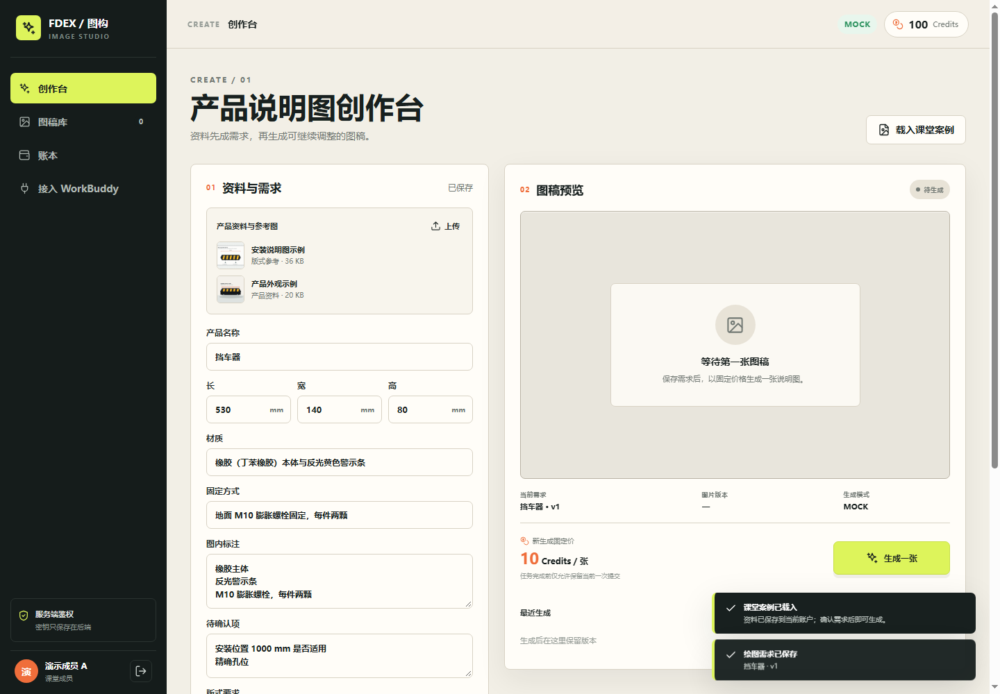

# FDEX 图构

网页与 WorkBuddy 共用的一套产品说明图生成服务。账户、Credits、任务、图稿版本和消费流水由同一个 Node.js 服务管理。



## 功能

- 账户登录、会话 Cookie 与 Bearer Token 鉴权。
- 上传产品资料，整理带来源和未知项的 `DrawingSpec`。
- 固定价格新生成，以及基于已有图稿继续调整。
- 任务状态、失败释放、结果未知保留预留、幂等提交和并发余额保护。
- 图稿 V1/V2/V3 版本关系、预览和下载。
- 管理员开通成员、重置密码、维护 Provider 配置和 Credits，API Key 不会返回浏览器。
- 成员可自行修改密码；改密会撤销全部旧网页会话和 WorkBuddy 令牌。
- MCP Server 供 WorkBuddy 调用同一套业务 API。
- Provider 支持 Mock、OpenAI Images 兼容接口和 DashScope 原生接口。

> Credits 只是教学点数，不是货币，也不支持在线购买或提现。

## 快速开始

要求 Node.js 24 或更高版本。项目没有第三方运行依赖。

```powershell
Copy-Item .env.example .env
npm start
```

打开 `http://127.0.0.1:4310`。首次使用前请在 `.env` 中修改 `DEMO_PASSWORD`。开发模式下会创建：

| 账号 | 角色 |
|---|---|
| `student_a` | 普通成员 |
| `student_b` | 普通成员 |
| `instructor` | 管理员 |

三个演示账户使用同一个 `DEMO_PASSWORD`。也可以在 `ADMIN_PASSWORD` 中设置独立的管理员密码，至少 12 个字符。

`.env.example` 默认使用 `IMAGE_PROVIDER=mock`，无需供应商密钥即可完整体验账户、任务、版本和 Credits 流程。Mock 输出是可预览和下载的 SVG 图稿。

## 账户开通

生产环境默认关闭自主注册。管理员登录后进入“成员与额度”，可创建普通成员或管理员、设置初始 Credits，并为成员重置密码。普通成员在“账户安全”中修改自己的密码。

创建账号、修改密码和重置密码后，服务会撤销该账户的全部网页会话和 WorkBuddy Token。成员需要使用新密码重新登录；若仍需 WorkBuddy 接入，应重新创建 Token。

## 容器部署

仓库提供 `Dockerfile` 和 `compose.yaml`。生产部署先准备环境文件：

```bash
cp .env.production.example .env.production
# 修改 APP_ORIGIN、ADMIN_PASSWORD 和 Provider 配置后：
docker compose up -d --build
curl http://127.0.0.1:4310/api/health
```

`compose.yaml` 默认只绑定 `127.0.0.1:4310`，应由 Caddy、Nginx 或云负载均衡终止 HTTPS。SQLite、上传资料和输出图稿保存在 `fdex-runtime` Volume。完整步骤见 [交付清单](docs/DELIVERY.md) 和 [部署与运维](docs/OPERATIONS.md)。

## 真实 Provider

切换到 OpenAI Images 兼容接口：

```dotenv
IMAGE_PROVIDER=live
IMAGE_API_BASE_URL=https://api.openai.com/v1
IMAGE_API_STYLE=openai
IMAGE_API_KEY=replace-with-your-key
IMAGE_GENERATE_MODEL=gpt-image-1
IMAGE_EDIT_MODEL=gpt-image-1
IMAGE_SIZE=1536x1024
IMAGE_QUALITY=medium
IMAGE_OUTPUT_FORMAT=png
IMAGE_RESPONSE_FORMAT=
```

切换到 DashScope 原生接口时，把 `IMAGE_API_STYLE` 设为 `dashscope`，并按供应商文档填写 Base URL、模型名和尺寸。管理员的系统设置页可以热切换 Provider，网页保存的配置会覆盖 `.env` 中的同名 Provider 配置。

真实生成与编辑会产生供应商费用。API Key 仅保存在服务端 `.env` 或 SQLite 设置表中，不会发送给浏览器或 WorkBuddy。

## 配置

| 变量 | 默认值 | 说明 |
|---|---|---|
| `APP_ENV` | `development` | `development`、`test` 或 `production` |
| `HOST` / `PORT` | `127.0.0.1` / `4310` | HTTP 监听地址 |
| `APP_ORIGIN` | `http://127.0.0.1:4310` | 外部访问地址；生产环境必须使用 HTTPS |
| `DATA_DIR` | `./runtime` | SQLite、上传资料和输出图稿目录 |
| `SEED_DEMO_ACCOUNTS` | 开发环境为 `true` | 生产环境必须关闭 |
| `DEMO_PASSWORD` | 开发环境回退值 | 演示账户密码 |
| `ALLOW_REGISTRATION` | 开发环境为 `true` | 生产环境默认关闭 |
| `INITIAL_CREDITS` | 开发环境为 `100` | 自主注册账户的初始点数 |
| `COOKIE_SECURE` | 根据 `APP_ORIGIN` 推断 | HTTPS 部署时应为 `true` |
| `TRUST_PROXY` | `false` | 仅在受信任反向代理后启用，用于读取 `X-Forwarded-For` |
| `AUTH_RATE_LIMIT_MAX` | `20` | 每个客户端 IP 在窗口期内的认证请求上限 |
| `AUTH_RATE_LIMIT_WINDOW_MS` | `300000` | 认证限流窗口 |
| `DUPLICATE_SUBMIT_WINDOW_MS` | `3000` | 相同付费请求的合并窗口 |

完整 Provider 变量见 [.env.example](.env.example)，生产模板见 [.env.production.example](.env.production.example)。

## 测试

```powershell
npm test
```

自动化测试覆盖账户开通与密码重置、旧凭据撤销、账户隔离、Credits 事务、失败释放、并发防透支、版本关系、MCP、Provider HTTP 合同、生产安全默认值、认证限流和 Windows 本地中文排版。

浏览器验收需要服务已启动，并会产生实际课堂 Credits：

```powershell
$env:SMOKE_PASSWORD = "your-demo-password"
npm run test:ui
npm run test:settings-ui
```

隔离测试环境可设置 `SMOKE_ACCOUNT_FLOW=1`，额外验证管理员开通成员、重置密码、成员自行改密和重新登录的完整浏览器流程。

浏览器脚本会自动寻找 Edge，也可以设置 `EDGE_PATH`。截图写入被 Git 忽略的 `runtime/`。

## WorkBuddy

1. 登录网页，在“接入 WorkBuddy”页面创建访问令牌。
2. 将页面生成的 MCP 配置合并到 WorkBuddy。
3. 引用 `workbuddy/SKILL.md`。
4. 先调用 `get_balance`，确认付费动作后再生成或编辑。

MCP 工具包括 `get_balance`、`list_assets`、`prepare_drawing_spec`、`generate_image`、`edit_image`、`get_image_job`、`list_images` 和 `list_image_versions`。更多说明见 `workbuddy/README.md`。

## 项目结构

```text
public/       网页界面与原创示例图
src/          配置、数据库、鉴权、业务服务、Provider 和 HTTP API
mcp/          WorkBuddy MCP Server
scripts/      本地启动、图片排版和浏览器验收
tests/        Node.js 自动化测试
docs/         部署、交付、迭代和截图
workbuddy/    WorkBuddy Skill 与 MCP 配置模板
Dockerfile    生产容器镜像
compose.yaml  单机 Compose 部署与持久化 Volume
data/         本地课堂案例素材，不进入公开仓库
runtime/      SQLite、上传和输出，不进入 Git
```

## 数据与安全

- `.env`、`runtime/`、日志、数据库、上传资料和生成图稿均被 `.gitignore` 排除。
- 公开仓库不包含课程手册、模板、PPT 或课堂原始案例资料。
- 生产模式强制 HTTPS Origin，关闭演示账户和自主注册，初始 Credits 默认为 `0`。
- 认证接口按客户端 IP 限流，Cookie 使用 `HttpOnly`、`SameSite=Lax`，HTTPS 下附加 `Secure`。
- 修改或重置密码会撤销目标账户的全部会话和 API Token。
- 不要在录屏、Issue、日志或截图中暴露 `IMAGE_API_KEY`、会话令牌或 MCP Token。怀疑泄露时应立即在供应商或网页中轮换。

## 已知限制

- SQLite 与单个 Node.js 实例适合课堂和轻量部署，不提供分布式任务队列或多实例写入协调。
- 当前没有自动数据库迁移框架；升级前应按[迭代流程](docs/ITERATION.md)备份并验证数据兼容性。
- 目前没有在线支付、团队组织、批量任务、多质量套餐和 OCR/视觉模型自动提取参数。
- Windows 上可用 `System.Drawing` 叠加确定性中文文字层；Linux 会跳过本地文字层并保留 Provider 原图。
- 模型输出的文字、尺寸和安装信息仍需人工复核，不应直接作为工程承载校核依据。

## 许可证

本项目使用 [MIT License](LICENSE)。
